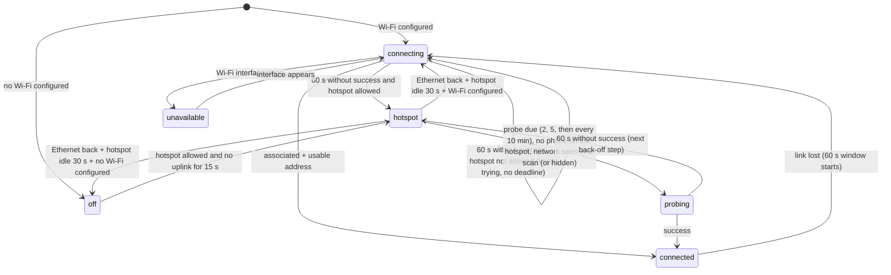

# Network management (phase 2b, step 3)

Status: implemented hardware-free and tested (UNIT with fakes and a SIMULATED radio; INTEGRATION with the real nft, dnsmasq, hostapd,
wpa_supplicant, systemd-networkd, Avahi and the Linux kernel in Docker; BROWSER with real Chromium). **Nothing here has run on a Pi, on a
real Wi-Fi radio or with real phones.** The hardware items are listed in section 11.

## 1. What the owner gets
* Ethernet and Wi-Fi, IPv4 (DHCP or fixed) and IPv6 (automatic, fixed or off), per interface.
* **Client Wi-Fi XOR setup hotspot, never both.** The hotspot opens only with owner-known per-device credentials (DECISIONS #56) and only
  when no network works: about 60 s after the configured Wi-Fi failed (provisional value from PRODUCT_SPEC), or 15 s after start without
  any configured Wi-Fi and without Ethernet. It closes again when the Wi-Fi works or an Ethernet link is back and nobody uses it.
* WebUI **Settings → Network** (DE/EN, mobile first): status (mode, signal, addresses, fallback countdown, time sync, firewall), Wi-Fi scan
  list with security, hidden networks, join, forget; addresses per interface; regulatory country and hotspot name/password. The host name
  stays in **Settings → Secure access** (`local_hostname`); the network page shows it.
* No lock-out: every change that affects the connection the owner may be using must be confirmed on the page within **3 minutes**, or it
  is undone automatically. A wrong Wi-Fi password is undone as soon as the attempt fails. Last resort: the SD-card `network-reset`.

## 2. Architecture and privilege boundary
```
 browser ──HTTP(S)──> bridge (user hifi-bridge, unprivileged)                     root-side agent hifi-netd (bounded root)
                      ├─ webui/views_network.py                                   ├─ netagent.Agent   (6 requests, uid check)
                      ├─ net/netclient.NetworkService ──UNIX socket────────────> ├─ netmanager       (pure state machine)
                      │    owns network.json + network.pending.json (0600)       └─ netsys.LinuxSystem (adapter)
                      └─ net/access.LocalAccess (mDNS, certificates)  <─status─      ├─ files in /run/hifi-net (0600, RAM)
                                                                                     ├─ /run/systemd/network/1x-hifi-*.network
   /var/lib/hifi-bridge/network.json  <──── read strictly (O_NOFOLLOW, owner, 0600,  ├─ systemctl start/stop hifi-net-{wpa,hostapd,dhcp}@wlan
                                            64 KiB) and validated again by the agent  ├─ nft -f (table inet hifi), iw (scan, reg set)
                                                                                      └─ hostnamectl + Avahi SetHostName (D-Bus)
```
* The bridge **never runs anything as root**. It writes only its own files and asks the agent over `/run/hifi-net/agent.sock`
  (`0660 root:hifi-bridge`, `SO_PEERCRED`: only uid 0 or the bridge's uid). Requests are one JSON object ≤ 4 KiB:
  `status`, `trial {id}`, `confirm {id}`, `revert`, `scan`, `hostname`. `id` must be 64 lower-case hex characters. There is **no request
  that carries configuration**: the agent reads the bridge's file itself and checks that its SHA-256 equals `id`.
* The agent treats the bridge's files as untrusted: `netconfig.read_strict` (no symlinks, regular file, owner hifi-bridge or root, mode
  without group/other bits, ≤ 64 KiB) and the full schema validation of `netconfig` (unknown keys rejected, problems reported as
  `field:reason` without values). An invalid `network.json` means Ethernet with DHCP only, and the status says so.
* The agent never writes into the bridge's data directory.
* Units (overlay of `os/br2-external`): `hifi-netd.service` (root with `CapabilityBoundingSet=CAP_NET_ADMIN CAP_NET_RAW CAP_DAC_READ_SEARCH
  CAP_CHOWN`, `ProtectSystem=strict`, write access only to `/run/hifi-net` and `/run/systemd/network`, read-only bridge data, systemd
  exposure 3.0), `hifi-net-wpa@.service`, `hifi-net-hostapd@.service`, `hifi-net-dhcp@.service` (each `Conflicts=` the other role, so
  **systemd itself** never runs client and hotspot together; exposure 2.9/2.9/3.4) and `hifi-firewall.service` (base ruleset before
  `network-pre.target`, without Python; exposure 2.2).
* Interfaces are found by type (`/sys/class/net/*`: `phy80211` = Wi-Fi, ARPHRD_ETHER with a device = Ethernet), so `eth0`, `end0`
  (Pi 4 with predictable names) and `enx…` work alike.
* Without an agent (Docker lab, development host) the bridge is *unmanaged*: the page shows the kernel's addresses (rtnetlink, no root)
  and offers no changes.

## 3. State machine (`btbridge/net/netmanager.py`)

* **Hotspot allowed** = hotspot credentials AND a regulatory country AND no Ethernet uplink (carrier + usable address).
* **Retry policy from the hotspot:** probes after 2 min, 5 min, then every 10 min. A probe is postponed by 1 min while any phone is
  associated (an owner configuring the device is never cut off). If an AP-mode scan works and the configured (non-hidden) network is not in
  it, the probe is skipped without taking the hotspot down. Each probe costs at most 60 s of hotspot downtime.
* Failure reasons shown to the owner (from wpa_supplicant events): `wrong_password` (WRONG_KEY), `not_found` (NETWORK-NOT-FOUND),
  `rejected` (ASSOC-REJECT), `no_address` (associated, no DHCP/RA address), `timeout`.
* All transitions and error cases are unit-tested with a fake clock and a fake adapter (`tests/unit/test_netmanager.py`, 36 test functions, 40 cases).

## 4. Owner changes (trials) and the pending file
1. The WebUI builds the new configuration; `NetworkService.save` validates it and writes `network.pending.json` (0600).
2. `trial {id=sha256}`; the agent validates the file again and applies it.
3. Results: `unchanged`; `confirmed` (the change does not touch a path the owner may be using, e.g. adding Wi-Fi while on Ethernet, or
   changing the hotspot while it is not running) → the bridge promotes the pending file to `network.json`; `pending` → the page shows
   “Keep the new network settings?” with a live countdown (JS) and *Keep* / *Undo now*.
4. A pending change is rolled back automatically: when its Wi-Fi attempt fails (reason shown), when 3 minutes pass without *Keep*
   (`not_confirmed`; if the device had reached the new network, its address is shown so the owner can try it), or on *Undo now*.
5. The bridge deletes the pending file whenever the agent no longer has that trial pending, and promotes it when the agent says
   `confirmed`. After a power cut or agent restart the agent starts from `network.json`, i.e. the last confirmed configuration.
   (Remaining window: a power cut in the milliseconds between the agent's `confirm` and the bridge's rename keeps the previous
   configuration - the safe direction.)

“Affects a path in use” = Ethernet change with carrier; Wi-Fi/country change while the client is connected; hotspot/Wi-Fi/country change
while the hotspot runs.

## 5. Setup hotspot and captive portals
* WPA2-PSK (CCMP), channel 6 (permitted in every regulatory domain), `ap_isolate=1` (clients cannot reach each other), at most 8
  clients, country code from the configuration (`ieee80211d=1`). WPA3-SAE in AP mode depends on the brcmfmac firmware (gate item N-4).
* Address `10.42.0.1/24`, DHCP range .10–.60, lease 1 h, **no default router and no DNS server** (dnsmasq with `port=0`). Phones see a
  local network without internet and do **not** get a fake captive-portal sheet; the setup page is `http://10.42.0.1/` (also printed in
  `hifi-status.txt`) or the mDNS name, which Avahi publishes on the hotspot link. Whether every phone keeps the connection without
  internet (or needs “stay connected” / mobile data off) is gate item N-5.
* The hotspot network may not overlap a fixed LAN address (validated: `conflicts_with_hotspot_network`).

## 6. Firewall (nftables, `table inet hifi`, IPv4 + IPv6)
Rendered by `netrender.nftables`, replaced atomically (one transaction). The base ruleset (`/usr/share/hifi-bridge/nftables-base.nft`,
pinned equal to the renderer by a test) is loaded before any interface is configured; the agent replaces it per radio role.

| Source | Allowed inbound | Everything else |
|---|---|---|
| all interfaces | loopback; replies to own connections (`ct state established,related`); ICMP errors; echo (rate-limited 10/s); ICMPv6 errors, packet-too-big, router advertisements, neighbour solicitation/advertisement, MLD query; mDNS (UDP 5353) | dropped (`policy drop`) |
| LAN (Ethernet, client Wi-Fi) | WebUI HTTP/HTTPS (80/443), stream (8090) for Lyrion and players; DHCPv4 replies (67→68); DHCPv6 replies from link-local (547→546); replies to the Lyrion discovery broadcast (source port 3483) | dropped |
| setup-hotspot clients | DHCP (67), WebUI HTTP/HTTPS only | dropped - no stream port, no other service |
| forwarding | nothing (`policy drop`; IP forwarding is off anyway) | |
Outbound is not restricted (Lyrion, MQTT, syslog, NTP, update checks are connections the device opens). Live-tested across containers:
LAN client reaches 80/443/8090, hotspot client reaches only 80/443, both have 2222 and 53 dropped although listeners exist, ICMP works,
a hotspot client cannot reach the LAN (`reports/evidence/network_realtools.txt`). The Pi kernel config (`bcm2711_defconfig`, used for all
three boards) builds `nf_tables`, `nf_conntrack`, `nft_ct`, `nft_limit` as modules; `modules-load.d/hifi-bridge-nftables.conf` loads them early.

## 7. Credentials
* Wi-Fi and hotspot passwords live only in `network.json` / `network.pending.json` (mode 0600, data partition, directory 0700). Sources:
  provisioning (flash tool / manual bootstrap file, docs/PROVISIONING.md), WebUI over the owner session, never MQTT.
* They are **never written as text** into daemon files: the WPA2 pairwise master key (PBKDF2-HMAC-SHA1, checked against
  `wpa_passphrase` and the IEEE 802.11i test vector) and, for WPA3, `sae_password` in hex. SSIDs are hex too, so no SSID or password byte
  can break a configuration line. (The real wpa_supplicant showed that a quoted passphrase with `#` or `"` was silently truncated - fixed.)
  The rendered files exist only in RAM (`/run/hifi-net`, 0600 root).
* Never shown back: password fields are always empty; the page says “leave empty to keep the stored password”. Status, `/api/network`,
  diagnostics (`netconfig.redact` → `password_set: true`), MQTT and logs never contain them; the passwords are added to the log redaction
  list as defence in depth. Problems are reported as `field:reason` without values. Tests scan every page, the status, the diagnostics
  bundle and the logs for the passwords.

## 8. Host name, mDNS, addresses
* `local_hostname` (owner setting, validated label) is applied by the agent as the transient system host name (`hostnamectl`; DHCP sends
  it, so many routers resolve it) and as Avahi's host name (`SetHostName`, root only) - **before** the bridge re-publishes, so Avahi itself
  publishes the name and keeps its addresses current on every interface, including the hotspot.
* When the address set changes (hotspot ↔ client Wi-Fi), the bridge re-checks the HTTPS certificate (SANs include private addresses such as
  10.42.0.1) and re-publishes its Avahi records at once instead of after the 60 s address poll.

## 9. Time
systemd-timesyncd (NTP servers from DHCP first, `pool.ntp.org` as fallback - owner decision proposed); the clock is saved on the data
partition (`/var/lib/systemd/timesync` bind-mounted), so a Pi without RTC starts with the last known time. The status shows whether the
clock is synchronised. Certificates: a certificate whose `notBefore` lies in the future (issued while the clock was ahead) is re-issued
(`not_yet_valid`), and after the first synchronisation of a boot the certificate is re-checked immediately (a clock that was far behind can
make it expire early). Outbound TLS (MQTT, syslog) keeps verifying and simply retries until the clock is right - no exceptions.

## 10. Failure handling and recovery
| Failure | Handling |
|---|---|
| wrong Wi-Fi password / network gone / no DHCP | reason shown; 60 s → hotspot (if allowed); WebUI change → rolled back to the previous configuration |
| wrong fixed address, wrong gateway, VLAN, … | not confirmed within 3 min → rolled back |
| router reboot | < 60 s: nothing happens; longer: hotspot, probes after 2/5/10 min bring the Wi-Fi back |
| power cut during a change | previous `network.json` applies; the pending file is removed |
| invalid or tampered `network.json` | agent: Ethernet + DHCP only, status “settings file unreadable”; fix via WebUI or `network-reset` |
| agent crash | `Restart=always`; wpa_supplicant/hostapd keep running (`RuntimeDirectoryPreserve=yes`); the base firewall stays loaded |
| device unreachable anyway | SD card: a file `hifi-recovery` with `network-reset` in the boot partition (journaled, exactly once, power-cut safe, DECISIONS #58/#64): forgets the client Wi-Fi and every fixed address, keeps country and hotspot credentials; `hifi-status.txt` names the hotspot and `http://10.42.0.1/`. Console: `python3 -m btbridge.recovery --data … network-reset`. Factory reset also removes the network files. |

## 11. Evidence and hardware tests still needed
| Check | Label |
|---|---|
| schema, renderers, state machine (all transitions/errors), adapters with fake runner/sockets, agent/client over a real UNIX socket, WebUI pages, recovery, redaction | UNIT (fake clock, SIMULATED radio) |
| nft/dnsmasq/hostapd/wpa_supplicant parse the generated files (negative controls fail); networkd applies fixed IPv4/IPv6 and netlink reads them back; PMK = `wpa_passphrase`; control-socket client vs. real wpa_supplicant (wired driver); Avahi `SetHostName`; `systemd-analyze verify`/`security` | INTEGRATION (Docker, `scripts/run_net.sh`) |
| live firewall and hotspot DHCP across three containers | INTEGRATION (Docker) |
| network pages in Chromium: axe-core, DE/EN, light/dark, phone/desktop, countdown, scan list | BROWSER (SIMULATED radio) |
| mac80211_hwsim (virtual Wi-Fi radios) | **not used**: needs a host kernel module; no module is loaded on the development host |

Hardware gate items (proposed for docs/HARDWARE_GATE_CHECKLIST.md):
* **N-1** client Wi-Fi on the on-board brcmfmac per board: WPA2, WPA2/WPA3 transition, WPA3-only, hidden SSID, 2.4/5 GHz, reconnect
  after router reboot (< 60 s and > 60 s), signal shown.
* **N-2** setup hotspot per board: phones (Android, iOS) join with the per-device password; DHCP lease without router/DNS; the setup page
  at `http://10.42.0.1/` and via the mDNS name; never together with the client (P6-2).
* **N-3** `iw dev wlan0 scan ap-force` in AP mode on brcmfmac (else the probe always takes the hotspot down for up to 60 s).
* **N-4** WPA3-SAE in AP mode on brcmfmac (currently WPA2 only).
* **N-5** captive-portal behaviour of current Android/iOS on a network without router/DNS (stays connected? needs mobile data off?).
* **N-6** regulatory domain: `iw reg set` and `country=` take effect on brcmfmac (`iw reg get`, allowed channels); rfkill unblock.
* **N-7** Ethernet interface naming per board (eth0 / end0 / enx…) and networkd DHCP/IPv6 SLAAC/DHCPv6 on a real router.
* **N-8** nftables modules load on the image; the base firewall is active before the first DHCP packet; measured boot delay.
* **N-9** timesyncd persistent clock across reboots without network; certificate re-check after the first sync.
* **N-10** `hostnamectl` + Avahi `SetHostName` on the image (name change visible to phones, collision rename).
* **N-11** hotspot + Bluetooth A2DP coexistence on the shared 2.4 GHz radio (Zero 2 W in particular, plan E5).
